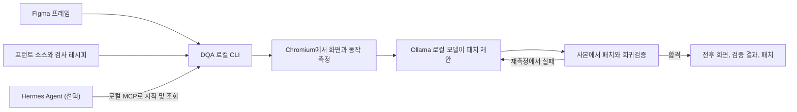
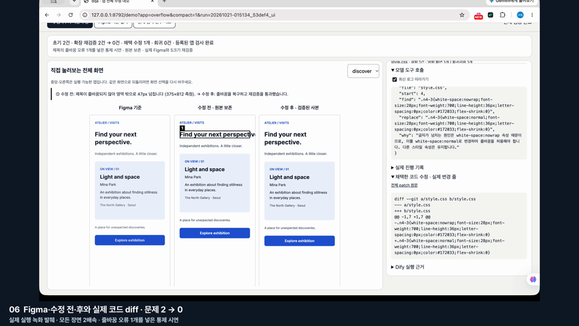

# DQA

Figma와 구현 화면을 비교하고, 로컬 모델이 작성한 프런트 수정안을 Chromium에서 검증합니다. 화면 모양과 함께 사용자가 버튼을 눌렀을 때의 동작, API 응답에 따른 화면 표시도 확인합니다.

## 주요 실행 경로



기본 예제는 Node.js, Chromium, 로컬 Ollama로 실행합니다. Dify, 임베딩 검색, gbrain, 맥미니 터널은 이 경로에 필요하지 않습니다. 검사 레시피가 화면과 사용자 흐름을 재현하고, Figma에서 가져온 기준과 브라우저에서 관측한 값을 모델에 제공합니다. 코드에서는 실제 요청 경로와 클릭 분기를 찾아 수정할 위치를 좁힙니다. 일부 진단은 저장소의 `knowledge/` 문서에서 규칙에 미리 연결된 문단을 함께 읽습니다.

Hermes Agent가 필요한 경우는 대화에서 등록된 프로젝트를 시작하고, 채팅을 마친 뒤에도 이어지는 검수의 상태를 조회하고 싶을 때입니다. Hermes는 프로젝트 ID와 실행 ID로 로컬 MCP를 호출합니다. 파일 읽기, 수정 후보 적용, 합격 판정은 같은 DQA 엔진이 담당합니다. CLI로 재현할 때도 같은 측정 결과와 통과 기준이 적용됩니다. [아키텍처와 Hermes 설정](docs/local-repair-architecture.md)

## 로컬에서 재현

Node.js, Playwright Chromium과 Ollama가 준비된 상태에서 저장소 루트에서 실행합니다.

```bash
cd dqa
npm ci
cd ..
node eval/fieldwork-service/prepare-repair.js
ollama pull qwen3.5:4b
node dqa/cli.js local-repair --profile dqa/workflow/fieldwork.json --mode model
```

Fieldwork 기본 프로필에는 실제 Figma에서 내보낸 프레임이 연결돼 있습니다. 새 시안을 쓸 때는 `node dqa/cli.js serve`로 DQA 웹을 열어 플러그인에서 프레임을 가져오고, 프로필의 화면별 연결을 지정합니다. 웹에서는 저장된 로컬 실행의 전후 화면과 패치도 열어 볼 수 있습니다. [Figma 플러그인](figma-plugin/README.md), [프로젝트 화면 찾기](docs/screen-discovery.md)

`local-repair`는 검사만 하는 `inspect`, 규칙 수정안을 검사하는 `rules`, 모델 수정안을 검사하는 `model`, 둘을 순서대로 쓰는 `hybrid` 모드를 지원합니다. 검증된 패치와 전후 캡처는 실행 폴더에 남습니다. 작업 폴더에 반영하려면 해당 실행의 검증 결과를 확인한 뒤 `dqa apply`를 사용합니다. [실행 옵션과 지원 범위](dqa/README.md)

## 실제 실행 결과

Fieldwork의 실제 Figma 프레임 5개와 구현을 대조했습니다. 로컬 Qwen3.5 4B는 제목 크기를 38px에서 시안 기준 26px로 복구했고, 클릭한 카테고리로 필터를 적용했으며, 상품 상세에서 목업 가격 대신 API 응답의 가격을 표시하도록 패치했습니다. 최종 재검증에서는 결함 7건 해결, 회귀 0건, 사용자 흐름 10/10을 기록했습니다. 추가 가격과 폭을 조합한 사례도 6/6 통과했습니다. 측정은 Fieldwork 데모의 등록 화면과 로컬 API 응답으로 진행했습니다. [전후 화면과 검증 결과](docs/local-repair-architecture.md#검증-결과), [검증 수치](docs/evidence/local-repair/verification.json), [검증된 모델 패치](docs/evidence/local-repair/fieldwork-model.patch)

## 기존 Dify 웹 워크플로

웹에서 새 검사를 시작하거나 웹 화면의 수정 버튼을 사용하는 기존 경로는 Dify 앱을 통해 실행됩니다. 검사 근거로 문서와 사례를 검색해 추가 검사를 고르는 기능에는 Dify 지식베이스와 임베딩 서버가 필요합니다. 이 웹 경로를 사용하는 경우 `dqa/config/default.json`에서 Dify 앱 ID와 모델 연결을 구성하고 자신의 환경에 맞게 도구 제공자와 지식베이스 ID를 등록해야 합니다. 기존 글자 넘침 데모와 해당 경로의 성능 실험은 아래에서 확인할 수 있습니다. [기존 웹 워크플로](dqa/dify/dqa-act.dsl.yml), [Dify RAG 구성](dqa/dify/rag/README.md), [글자 넘침 데모](docs/evidence/overflow-20261021.json), [기존 실행 시간 비교](docs/performance-20261021.md)

<details>
<summary>기존 글자 넘침 데모와 실행 시간</summary>



기존 Dify 데모에서는 같은 넘침 원인으로 기록된 결함 2건을 모델이 CSS에서 수정했고, 다섯 화면 폭에서 다시 확인했습니다. 기존 경로와 같은 검증 범위를 두고 전후 3회씩 실행했을 때 전체 실행 시간의 중앙값은 143.8초에서 98.8초로 줄었습니다. [기존 실험의 범위와 결과](docs/performance-20261021.md)

</details>

전체 테스트는 `cd dqa && npm test`로 실행합니다.
