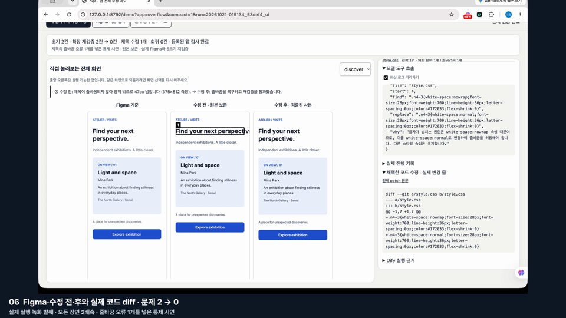
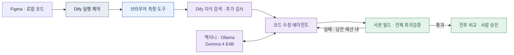

<div align="center">

# dqa
### Figma와 구현 화면을 비교하고, 코드 수정까지 검증합니다.

**Dify · 브라우저 측정 · 로컬 코드 에이전트 · 회귀검증**

</div>



> 실제 실행 화면입니다. Figma에서 가져온 시안과 글자 넘침을 넣은 데모를 비교했습니다. 모델이 파일을 읽고 CSS를 수정했고, 다섯 화면 크기에서 다시 확인했습니다. 이 사례는 통제된 데모이며 실제 서비스 전반의 성능을 뜻하지 않습니다.

## 무엇이 달라지나요?

AI로 구현한 화면도 작은 화면에서 글자가 넘치거나 버튼이 가려지고, 공통 컴포넌트를 고치면 다른 화면이 깨질 수 있습니다. dqa는 디자이너가 검토하기 전에 문제 위치와 측정값을 보여주고, **모델이 제안한 수정을 사본에서 실행해 확인**합니다.

1. **가져오기** — Figma 프레임과 로컬 프런트 프로젝트를 연결합니다.
2. **검사 시작** — Dify가 도구를 호출합니다. 브라우저가 요소 좌표·스타일·클릭 결과를 측정하고 시안과 대조합니다.
3. **수정** — 코드 에이전트가 소스를 읽고 수정 방법을 고릅니다. 실제 도구 호출과 diff가 화면에 표시됩니다.
4. **재검증** — 사본을 빌드하고 등록한 화면과 크기를 다시 검사합니다. 실패한 수정은 채택하지 않습니다.
5. **승인** — 전후 화면과 코드를 사람이 확인한 뒤 원본에 적용합니다.

## 어떻게 연결되나요?



**측정 도구**가 숫자로 결함을 찾습니다. **모델**은 코드를 읽고 수정 행동을 선택합니다. 수정 성공 여부는 모델의 설명이 아니라 재측정과 테스트 결과로 결정합니다. 웹 검사의 진입과 수정 실행은 모두 Dify를 거칩니다. 코드 수정 루프 안의 모델 호출은 dqa가 로컬 Ollama에 직접 요청합니다.

Dify RAG에는 검사 절차, 판정 규칙, 문서와 수정 사례를 넣습니다. 관측한 CSS 경계와 버튼 정보를 검색어로 사용하고, 근거가 있는 추가 검사만 실제 브라우저에서 실행합니다. 보고서 설명문은 별도 선택 기능이며 위 데모에서는 끈 상태입니다.

## 실행에서 확인한 것

| 항목 | 글자 넘침 데모 |
|---|---|
| 발견 → 수정 후 | 결함 보고 2건 → 0건 (같은 넘침 원인) |
| 모델 행동 | 파일 읽기 → 코드 편집 |
| 재검증 | 화면 크기 5개, 새 결함 0건 |
| 실행 경로 | Dify 검사 + Dify 수정 모두 성공 |
| 원본 | 유지, 검증된 사본 제공 |

[실행 ID와 검증 수치](docs/evidence/overflow-20261021.json) · [코드 수정 루프](dqa/fix/agent.js) · [재검증 코드](dqa/fix/fix.js)

## 같은 사례를 더 빠르게 검사하기

Dify 경로와 전체 검증 범위를 유지한 채 동일 글자 넘침 사례를 전후 3회씩 실행했습니다.

| 전체 실행 시간 · 중앙값 | 개선 전 | 개선 후 |
|---|---:|---:|
| 검사 → 모델 수정 → 재검증 | 143.8초 | **98.8초** |

**약 31% 단축.** 여섯 실행 모두 같은 두 결함을 해결했고, 수정 CSS와 크기별 측정값이 같았습니다. 화면 크기 5개·버튼 검사 크기 3개를 유지했습니다. 한 통제 사례의 결과이며 전체 서비스 성능을 뜻하지 않습니다.

[반복 실행 수치·검증 범위·개선 내용](docs/performance-20261021.md)

## 로컬 실행

현재 개발 환경은 macOS, Node.js, 실제 Chromium, Docker의 로컬 Dify, Ollama입니다. Dify 앱·지식베이스와 모델 연결을 먼저 구성해야 하며, 복제 후 바로 실행되는 클라우드 서비스는 아닙니다.

```bash
cd dqa
npm ci
# config/default.json의 Dify 앱 ID, Ollama 주소, SSH 대상 등을 자신의 환경에 맞게 설정
node cli.js doctor
node cli.js up     # 설정한 맥미니에 SSH 포트 포워딩
node cli.js serve # http://127.0.0.1:8792
```

웹 새 검사 화면에서 Figma 프레임을 가져오고, 로컬 프로젝트 폴더를 넣으면 화면 후보를 찾아 프레임과 연결합니다. 화면 탐색은 소스를 정적으로 읽으므로 로그인·클릭 이후 상태는 직접 경로를 추가해야 합니다. Figma 플러그인 자동 실행은 macOS 메뉴 조작 방식이라 최초 플러그인 등록과 손쉬운 사용 권한이 필요하며, 권한이 없으면 안내만 표시합니다. 시안 데이터는 **가져오기** 또는 **이 시안 다시 가져오기**를 눌렀을 때만 바뀝니다.

### 설정에 따라 실행되는 범위

| 준비한 것 | 실행할 수 있는 것 |
|---|---|
| Node.js, Playwright Chromium | `npm test`, CLI 검사(`check --local … --llm off`): 크기별 측정·시안 비교·원인 후보 |
| + 로컬 Dify(Docker)와 임베딩 서버 | 웹 검사. 검사·수정 시작은 Dify 앱을 거치며, 임베딩 응답이 없으면 RAG 추가 검사를 불완전으로 표시합니다 |
| + Ollama(Gemma 4 E4B) | 모델 코드 수정과 재검증, 문제 설명문 |

모델 서버는 `config/default.json`의 `ollama.url`(기본은 SSH 포워딩 포트)과 `mac_mini.ssh`(여유 메모리 확인용 SSH 대상)를 자신의 환경으로 바꿔야 합니다. SSH로 메모리를 읽지 못하면 doctor는 실패로 표시하지만, 모델 호출 자체는 막지 않습니다.

Dify 앱과 지식베이스는 이 저장소만으로 전부 복원되지 않습니다. DSL(`dqa/dify/*.dsl.yml`)과 생성 스크립트(`dqa/dify/act_v6.py`, `dqa/dify/rag/load.py`)에는 작성자 환경의 도구 제공자·지식베이스 ID가 들어 있으므로, 자신의 Dify에서 도구 등록(`dqa/dify/dify.py register`)과 지식베이스 생성 뒤 ID를 바꿔 가져와야 합니다. 공개 지식 문서는 `knowledge/`와 `dqa/dify/rag/corpus.json`뿐이며, 작성자 지식베이스의 기존 사례 청크는 포함하지 않습니다.

- [실행 옵션과 규칙](dqa/README.md)
- [Figma 플러그인](figma-plugin/README.md) · [프로젝트 화면 찾기](docs/screen-discovery.md)
- [Dify 워크플로 DSL](dqa/dify/dqa-act.dsl.yml) · [RAG 구성](dqa/dify/rag/README.md)
- 테스트: `cd dqa && npm test`

## 수정 범위와 한계

한 작업의 모델 행동은 최대 12단계, 편집 시도는 최대 3회입니다. 읽지 않은 파일은 수정하지 못하며, 경로·원문·문법 검사를 거칩니다. 검증된 수정도 원본 반영은 사람이 승인합니다. 맥미니 여유 메모리가 기준보다 부족하면 모델 수정을 중단합니다.

기본 검사는 데스크톱 Chromium의 모바일 화면 크기 5개입니다. 실제 기기의 키보드·안전영역·폰트 차이를 모두 재현하지는 않습니다. 등록되지 않은 화면과 상태는 회귀검증 범위에 포함되지 않으며, 통제된 데모 결과를 미사용 서비스 성능으로 일반화하지 않습니다.

이 저장소에는 도구 코드, 테스트, 재현용 데모와 공개용 실행 화면을 포함합니다. 개인 환경의 실행 기록·Figma 내보내기·팀 서비스 원본 덤프는 포함하지 않습니다.
