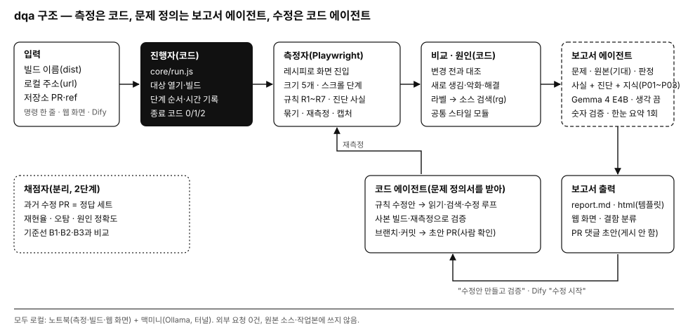

# 7주차 — 구조 설계: 디자인-구현 결함 검수 에이전트(dqa)

> 수업 저장소(ai-agent-course)의 7주차 산출물을 옮긴 것이다. 문서 안의 `design_qa/`, `tools/`, `w3/docs` 경로는 그 저장소 기준이며, 이 저장소에서는 각각 뿌리, (없음), `knowledge/`에 해당한다.

조대흠(20220225) · 실전 AI 에이전트 시스템 설계·구축 · 7주차 · 2026-10-09 초안 · 실행: 노트북(측정·빌드·웹 화면) + 맥미니(Ollama 0.40.1, Gemma 4 E4B)

> 7주차 과제 양식은 아직 받지 않았다(6주차 슬라이드 50번의 예고: "고른 모델과 5주차의 역할·도구·RAG를 하나의 시스템 설계로 통합"). 아래는 실제로 구현하고 잰 구조다. 양식을 받으면 맞춰 고친다.

## 1. 무엇을 바꿨나: 시연용 에이전트 → 매일 쓰는 도구

1~6주차 에이전트를 실제로 쓰려고 보니 다음 다섯 가지가 막혔다(10-09 코드 조사).

| 막힌 점 | 근거 | 바꾼 것 |
|---|---|---|
| 검사 대상이 PR #221 한 건, 화면 2개로 코드에 박혀 있다 | `tools/server.js:19-27` | 대상(빌드 이름·로컬 주소·저장소)과 화면 진입 레시피(JSON)를 입력으로 받는다 |
| 결과가 Dify의 3줄 답뿐이다(원인 파일·캡처·새 결함 구분 없음) | 4주차 출력 형식 | 결함 레코드, 변경 전과 비교, 원인 후보 file:line, 캡처, 보고서, 웹 화면 |
| 작은 모델이 도구 순서를 정하니 느리고 흔들린다 | 4주차 질문당 40~100초, 6주차 벤치 | 순서는 코드가 정하고, 모델은 해석만 한다(LLM 호출 상한 6회) |
| 고치는 방법은 사람 몫이다 | — | 수정안을 평가용 사본에 적용·빌드·재측정해 검증된 패치만 낸다(사용자 요청) |
| 터널·서버를 손으로 띄운다 | — | `dqa doctor`·`dqa up`·`dqa serve` |

## 2. 역할(5주차) · 모델(6주차) · 도구(4주차) · 지식(3주차)을 한 구조로

| 역할 | 맡는 것 | 실체 | 모델 |
|---|---|---|---|
| 진행자 | 대상 열기(빌드 이름·로컬 주소·저장소 PR·브랜치), 단계 순서, 시간·종료 코드 | `dqa/core/run.js`, `dqa/targets/` | 없음(코드) |
| 측정자 | 레시피로 화면 진입, 크기 5개·스크롤 단계 측정, 규칙 R1~R7, 진단 사실, 묶기, 재측정 | `dqa/measure/` (Playwright) | 없음 |
| 비교·원인 | 변경 전과 대조, 라벨·aria로 소스 검색, 컴포넌트 정의, 공통 스타일 모듈, 바뀐 줄 | `dqa/diff/`, `dqa/code/` | 없음 |
| **보고서 에이전트** | 결함마다 문제 정의서(무엇이 문제인가 · 원본(기대)은 어떠해야 하는가 · 결함인가 의도인가), 한눈 요약 | `dqa/judge/` | Gemma 4 E4B, 생각 끔(6주차 선정) |
| **코드 에이전트** | 문제 정의서를 받아 규칙 수정안 → 코드 읽기·검색·수정 루프, 수정마다 사본 빌드·재측정으로 검증, 수정 브랜치·커밋·PR 본문, 초안 PR(사람 확인) | `dqa/fix/` | 규칙 우선, Gemma 보조 |
| 보고서 출력 | report.md·html·패치·PR 본문, 웹 화면, 결함 분류(무시) | `dqa/report/`, `dqa/ui/` | 없음(템플릿) |
| 채점자 | 정답 세트·재현율·오탐·원인 정확도·기준선 | `eval/`(2단계) | 에이전트와 분리 |

- **에이전트 사이의 계약:** 측정 결과(`defects.json`) → 보고서 에이전트의 문제 정의서(`judge.problem`·`judge.expected`·`judge.verdict`) → 코드 에이전트의 수정 시도·검증 결과(`fix/fixes.json`) → 검증된 패치(`fix/fix_all.patch`) → PR(`fix/pr.json`, `fix/pr_body.md`).
- **에이전트를 둘로 나눈 이유(10-09 사용자 결정):**
  - 보고서 에이전트는 문제와 원본(기대)을 정하고, 코드 에이전트는 그 정의를 받아 고친다. 문맥(측정·지식 대 코드)과 시간 한도가 다르다.
  - 둘 다 같은 Gemma 모델을 차례로 쓰므로 맥미니 메모리는 늘지 않는다.
  - 보고서 본문(숫자·파일:줄)은 템플릿이 쓴다. LLM은 문제 정의와 한눈 요약만 쓴다.
- **모델:** 6주차 결론대로 Gemma 4 E4B를 생각하기 끔으로 쓴다. Dify 플러그인은 끔 값을 보내지 못했으므로, dqa는 Ollama `/api/chat`에 `think:false`를 직접 보낸다(중계기 불필요).
- **도구:** 4주차 `inspect_screen`의 규칙 4개(R1·R2·R3·R6)를 옮기고 R4·R5·R7과 진단을 더했다. 4주차 도구 서버(`tools/server.js`)는 그대로 두어 4주차 Dify 앱이 계속 동작한다.
- **지식(RAG):** 3주차 지식 문서(w3/docs P01·P02·P03)를 쓴다. 임베딩 검색 대신 **진단 코드가 문서 단락을 고른다**(예: flex 최소 폭 진단 → P02 4절 "입력칸에 minWidth: 0"). 맥미니 임베딩 서버가 필요 없고, 근거가 항상 같은 단락이라 재현된다.

## 3. 처리 흐름과 데이터

1. 대상 해석
2. 빌드 캐시 확인
3. 레시피로 진입
4. 크기마다 새 브라우저 컨텍스트, 배치가 멈출 때까지 기다림
5. 스크롤 단계마다 규칙 적용
6. 같은 줄·같은 규칙 묶기
7. 크기 사이 잇기
8. 한 크기 재측정
9. 변경 전과 비교
10. 원인 후보
11. LLM 해석(숫자 검증)
12. 보고서
13. (요청 시) 수정 검증

- **결함 레코드(`defects.json`):** 규칙, 요소(라벨·선택자·컴포넌트·계산 스타일), 크기별 px(화면 기준·시안 기준), 근거 M1…, 진단, 캡처, 비교 상태, 원인 후보(file:line·근거·점수), 해석(검증 여부), 신뢰도(코드 계산).
- **신뢰도는 코드가 정한다:** 재현된 크기 수, 재측정 일치, 기준 대비 여유, 원인 점수. LLM은 신뢰도를 정하지 않는다.
- **LLM 답 검증:** 원인·수정 문장에 나온 숫자가 측정 사실에 없으면 고칠 방법을 적어 한 번 다시 묻는다. 그래도 틀리면 규칙 문장으로 대체한다(6주차 `score_bench.py`의 정직성 검사와 같은 생각).

## 4. 안전장치

| 위험 | 장치 |
|---|---|
| 팀 코드·화면 외부 유출 | 대상은 로컬 주소·등록된 빌드만. 브라우저는 앱 출처 밖 요청을 막고 기록(실측 0건). LLM은 맥미니 로컬 모델만 |
| 사용자 작업본 손상 | `~/Come-back-home` 경로는 코드에서 거부. 수정 검증은 `~/design-qa-cases/fix/` 사본에서만 하고 끝나면 지움 |
| 맥미니 과부하(10-08 사고) | 다른 모델이 올라가 있거나 여유 20% 미만이면 LLM 건너뜀, 끝나면 모델 내림, 이미지 안 보냄 |
| 잘못된 수정 | 사본에 적용해 다시 빌드·재측정, 그 결함이 사라지고 다른 결함이 생기거나 커지지 않을 때만 채택 |
| 외부 게시 | PR 댓글·GitHub 쓰기 없음. 초안·패치 파일만 만든다 |
| 다른 웹페이지의 요청 위조 | 웹 화면은 127.0.0.1만, 브라우저 요청은 `X-DQA` 머리글 필수 |

## 5. 검증 결과(2026-10-09, 실데이터)

| 검증 | 결과 |
|---|---|
| 규칙 단위 시험(결함을 심은 페이지 6종 + 깨끗한 페이지) | 7/7 통과 |
| #221 결함 전 대 수정 후(크기 5개) | 새로 생김 3건(넘침·탭 라벨 겹침·줄바꿈), 종료 코드 1. 반대 방향은 해결 3건·새로 생김 0건, 종료 코드 0 |
| 넘침 px | 화면 기준 375 45px, 390 47px, 430 52px(시안 기준 모두 45px). 기존 실측(GATE_221) 45/47/51px와 1px 차이(반올림 순서) |
| 수정 후 빌드 단독(크기 5개) | 결함 0건(오탐 0) |
| 재측정 일치 | 3/3 |
| 원인 순위(변경 정보 없이) | 넘침 1위, 줄바꿈 1위가 `ReportScreen.tsx`. 탭 라벨 겹침은 3위가 `theme/tabBar.ts`. 셋 다 #221이 실제로 고친 파일 |
| LLM 해석 | 3건 모두 숫자 검증 통과, 건당 10~16초. 넘침은 "flex 항목 기본 min-width" 원리를 짚었지만 수정 제안이 흐렸고, 줄바꿈 원인은 틀렸다. 진단·지식 근거를 함께 보여 준다 |
| 수정 검증 | 넘침 규칙 수정안(`appearanceInput`에 `minWidth: 0`) 통과. #221이 실제로 한 수정과 같다. 함께 적용하면 넘침·줄바꿈 2건이 사라지고 다른 결함 0건. 줄바꿈 자체 수정안(`flexShrink: 0`)은 넘침을 71px로 키워 탈락. 탭 라벨 겹침은 LLM 수정안 2개가 모두 결함을 못 없애 "검증된 수정 없음" |
| 소요 시간 | 비교 검사 LLM 없이 약 29초, LLM 포함 약 70초. 수정 검증 약 2분(사본 10초, 빌드 2~7초씩, 재측정 12초씩) |
| 아무 웹앱(로컬 대시보드, 크기 4개) | 처음 4건 중 3건이 오탐(안쪽 여백을 줄 수로 셈, 줄 수 제한 잘림, 위쪽 머리글). 규칙을 고친 뒤 2건: 하단 내비게이션에 가려진 마지막 줄(진짜 결함), 줄 수 제한 잘림("사람 확인 필요") |
| Dify 얇은 앱 | 빌드·화면을 고르면 `dqa_check` 도구가 검사해 요약을 돌려준다. 21.2초, LLM 없음 |
| 저장소 모드(GitHub 독립 클론) | `--repo cbh --pr 221` 첫 실행 75초(커밋별 worktree·node_modules 복제·빌드 2~3초), 캐시 적중 41초, 해결 4건(신고 화면 3 + 보호자 홈의 탭 라벨 겹침 1). develop(10-07) 두 화면 결함 0건 |
| 보고서 에이전트(문제 정의) | 3건 모두 숫자 검증 통과. 넘침의 원본(기대)을 "입력 필드에 minWidth: 0이 적용돼 부모 안에서 줄어들어야 한다"로 정의(지식 P02-4 근거) |
| 코드 에이전트(문제 정의 → 수정) | 넘침: 규칙 수정안 통과. 줄바꿈: 규칙 1번·LLM 3번 모두 탈락(2번은 넘침을 71px로 키움, 2번은 결함이 남음). 탭 라벨 겹침: 코드를 읽다가 포기. 함께 적용하면 2건 사라짐, 다른 결함 0건. 175초 |
| PR 준비(로컬) | 독립 클론에 수정 브랜치·커밋(한 줄 변경), 타입 검사 통과, 팀 PR 양식 본문. 9.6초. GitHub에는 올리지 않음(확인 문구 없이 부르면 거부됨을 Dify로 확인) |
| Dify 작업 앱 | 작업(검사·상태·수정 시작·PR 준비·PR 올리기)을 사람이 고르면 `dqa_act`가 처리. 상태 조회 0.5초 |

**이 결과를 일반 성능으로 볼 수 없는 이유**
- #221과 대시보드는 규칙과 원인 순위를 다듬는 데 쓴 개발용 사례다.
- 재현율·오탐·원인 정확도는 2단계에서 따로 떼어 둔 정답 사례(과거 수정 PR 6~8건)로 잰다.
- 기준선은 B1 한 장 비교, B2 LLM 없음, B3 코드만 보는 LLM이다.

## 6. 다음 단계

1. 코드 에이전트 보강: 4B 모델은 탐색·수정 루프가 약하다(지어낸 파일 경로, 같은 수정 반복). 규칙 수정안 유형을 늘리고, 실패 이유를 더 구체적으로 돌려준다.
2. 2단계(8주차 MVP)
   - 정답 사례 6~8건과 채점기
   - 기준선 3종 비교
   - Figma 개발 플러그인(디자인 값과 비교)
   - 모델이 순서를 정하지 않으므로 탐지 재현율은 B2(LLM 없음)와 같다. LLM의 몫은 오탐 감소, 원인 1위 상승, 설명·수정 품질로 잰다.
3. 3단계: 상태(눌림·포커스·비활성), 키보드·안전영역 흉내, Figma 레이어와 화면 요소 짝짓기.

## 부록: 실행 방법

`design_qa/dqa/README.md` 참고. 웹 화면은 `node dqa/cli.js serve` 후 http://127.0.0.1:8792.
