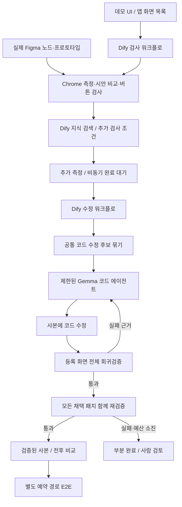

# ADR-007: Dify를 통과하는 앱 단위 피드백 수정 루프

**Status:** Accepted for registered-screen MVP  
**Date:** 2026-10-16  
**Deciders:** 사용자 요청에 따라 구현, 원본 반영은 사용자가 확인

## Context

단일 화면의 전후 비교와 CSS 수정을 순서대로 실행하는 기존 방식은, 공통 스타일 변경이 정상 화면을 깨뜨리는 문제를 충분히 설명하지 못했다. 사용자는 Dify를 반드시 거치고 실제 Figma·프런트에서 실패 후 재계획과 다른 화면 회귀검증을 확인하도록 요청했다.

## Decision

Dify는 검사·검색·완료 대기·수정 진입을 제어한다. dqa 도구 내부의 제한된 Gemma 코드 에이전트는 실패 관측에 따라 `read`, `search`, `replan`, `style`, `edit`, `give_up`을 선택한다. 수치 판정과 채택 결정은 측정기와 검증기가 담당한다. 여러 화면에서 같은 파일·코드·기대값의 수정 후보는 하나의 작업으로 묶는다. 영향 분석 누락을 피하기 위해 후보마다 등록 화면 전체를 다시 검사한다.

## 7주차 설계 항목에 대응

| 항목 | 구현 |
|---|---|
| 목표·성공 기준 | 선택된 결함 해결, 새 결함·악화 0, 기준 검사 범위 누락 0, 전체 원본 결함 미해결 시 partial |
| 구성 요소 | Dify 워크플로·지식베이스, Figma exporter, Chrome 측정기, 후보 묶기, 코드 에이전트, 검증기, 데모 UI |
| 데이터 흐름 | Figma 값·브라우저 관측 → 결함 → 소스 후보 → 수정 도구 → 실제 재측정 → 피드백 |
| 상태·메모리 | run별 manifest·app-plan·후보 결과·모델 행동·전후 캡처를 원자적 JSON으로 저장. 정확한 중간 대화 재개는 미구현 |
| 사람 개입 | 원본 적용·되돌리기·PR 올리기에는 기존 사람 확인 문구 유지. 데모는 별도 검증 사본만 공개 |
| 실패 처리 | 회귀 후보 거부, replan 선행 요구, 동일 코드 결과 재시도 차단, 정의되지 않은 범위·변수 거부, 유한 수정 예산, Dify 장애 시 우회 실행 금지 |
| 비용·지연·개인정보 | 모델은 Mac mini Gemma 4 E4B, 동시 모델 호출을 피함. 검사 쓰기 요청 대역·외부 요청 제한. 전체 화면 회귀검증 때문에 수분 소요 |

## Options considered

| 방식 | 장점 | 비용·한계 |
|---|---|---|
| 화면별 정해진 CSS 교체 | 빠르고 단순 | 정상 화면 회귀에 맞춘 수정 범위 재계획이 약함 |
| 자유로운 코딩 에이전트 | 큰 변경 가능 | 작은 모델의 경로·변수 추측, 범위 통제·시간 관리 어려움 |
| 제한된 도구 + 실제 피드백 루프 (채택) | 실패 근거에 따라 다음 행동 선택, 검증 과정 재현 가능 | 등록 화면 필요, 도구 범위 밖 수정은 사람 검토 |

## Consequences

첫 앱 전체 검사에서 발견한 Dify 추가 검사 50초 제한을 비동기 작업과 45초씩의 유한 완료 대기로 바꿨다. 정상 완료까지 로컬 서버를 유지하고 취소 시 해제한다. 작은 모델이 전역 수정 실패를 설명한 뒤 같은 패치를 반복하는 사례가 실제로 발생하여, 실제 화면별 코드 사용처와 클래스 범위 수정 도구를 추가했다. 결과는 측정기가 다시 검사한다.

앱 그래프의 자동 발견, React AST 수준의 완전한 의존성 분석, 모든 상태·권한 탐색, 다중 에이전트, 중간 대화 자동 재개는 구현됐다고 주장하지 않는다. 현재는 4개 화면의 Atelier와 5개 화면의 Fieldwork 앱을 등록하여 검증하는 MVP다. 공통 후보 분류와 작업 순서는 결정적 정책이며, 실패 후 수정 범위·도구·코드는 모델이 선택한다.

## Action items

- [x] 실제 Figma 4화면과 공유 Action 변형 구성
- [x] 공통 후보 묶기와 정상 화면 회귀검증
- [x] 실패 근거 기반 모델 재계획과 범위 수정 도구
- [x] Dify 비동기 완료 대기
- [x] 직접 실행 가능한 전후 앱 UI
- [x] 폼 오류·데이터 상태를 포함한 Fieldwork 서비스 평가 구현
- [ ] 인증·권한 및 실제 백엔드 상태 평가 확대
- [ ] 재개 가능한 에이전트 대화 체크포인트

## 2026-10-16: 서비스 수준 평가 확장

Fieldwork 체험 예약 서비스 5개 화면을 추가했다. 검색·재고·인원·쿠폰 계산·폼 검증·예약 지속·취소 확인이 실제로 동작한다. Figma의 정상 기준본과 의도적 오류 구현, 에이전트가 읽지 않는 정답 목록을 구분했다.

후보 검증에 신뢰된 레시피의 사용자 흐름을 추가했다. 기준 앱부터 실패하는 흐름을 이유로 수정을 막지 않는다. 중간 후보는 정상 흐름을 깨거나 기존 실패 지점을 앞당길 수 없으며 최종 묶음은 모든 흐름을 통과해야 한다. 이 검증은 앱 수정 폴더 밖에 있어 에이전트가 테스트를 삭제해 성공시킬 수 없다.

프로토타입 이동이 없는 취소 버튼도 Figma의 채움과 직접 라벨을 근거로 정상 변형 계약에 포함한다. 공통 CSS 목록의 일부 요소만 대상이면 해당 선택자만 별도 규칙으로 수정한다. 후보 수 예산은 공통 원인 묶음 이후 적용하고, 이미 채택한 후보로 함께 해결된 파생 작업은 중복 수정하지 않는다. 최종 묶음 검증은 생략하지 않는다.

별도 독립 검증기는 5화면×5크기의 실제 스타일, 15개 기능 확인×5크기, 원본 파일 해시, Dify 검사·수정 실행 ID, 모델 재계획 및 정상 화면 회귀 거부 기록을 확인한다. 결과는 실제 실행 완료 후 evidence에 기록한다.

모델이 설명을 듣고도 전역 선택자나 한 화면만의 선택자를 반복하는 실제 실패가 있었다. 공통 작업의 전체 대상 목록을 입력하고, 공통 색상 회귀 이후에는 실제 클래스 사용처와 Figma 기대값에서 전체 대상 화면을 포함하면서 정상 변형과 충돌하지 않는 선택자를 계산한다. 이 결과만 모델의 JSON 도구 스키마 선택지로 제공한다. 특정 앱 이름이나 정답 패치 목록은 사용하지 않는다. 모델은 재계획과 허용된 범위 선택을 하고, 적용 뒤에는 실제 측정과 사용자 흐름 검증을 다시 수행한다.

스크롤·줄바꿈이 바뀌면 한 화면 안의 요소 수가 달라지므로 삭제 검사에 최대 가시 요소 수를 사용하지 않는다. 렌더링된 전체 문서 콘텐츠의 중복 개수까지 비교해 삭제·숨김을 막는다. 중지 요청은 종료 신호를 무시하는 브라우저 의존성이 있어도 대기 시간 뒤 소유한 자식 프로세스 그룹을 종료한다.
