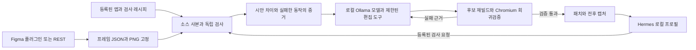
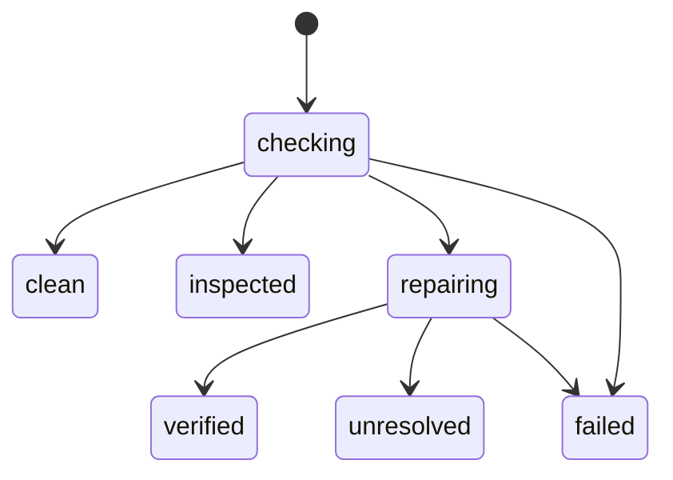

# Figma 프런트 자동 수정과 검증 설계

작성일 2026-11-27

DQA는 Figma에 맞춰 구현한 프런트에서 시각적 차이와 사용자 동작의 실패를 찾아 기존 소스의 수정안을 만든다. 정상 화면과 정상 시나리오를 다시 실행한 뒤에만 검증된 수정 사본을 제공한다. 프런트가 API에서 받아야 하는 제목, 가격, 재고 등은 해당 응답에 맞춰 변화해야 한다. Figma 안의 예시 값은 시각 검증의 기준으로 사용하고, 실제 값은 브라우저에서 독립적으로 확인한다.

## 구성과 실행 순서



| 단계 | 입력과 출력 | 실패 처리 |
|---|---|---|
| 프레임 연결 | 프레임 ID와 버전이 식별되는 JSON과 PNG를 시작 URL 및 검사 크기에 연결한다. 검사 시 파일을 실행 기록에 복사한다. | 지정된 프레임이나 파일이 없으면 자동 수정 시작을 막는다. |
| 소스 준비 | 기존 로컬 대상 빌더가 프로젝트 사본을 만든다. 시나리오와 검사 기준은 편집 대상 소스 밖에 둔다. | 브라우저 또는 빌드가 실패하면 결함 해결 여부를 미확인으로 둔다. |
| 진단 | DOM과 계산 스타일을 Figma JSON과 비교한다. 클릭 흐름의 실패에는 시나리오 ID, 실패 단계, 기대값, 관측값, 화면 크기, 캡처를 남긴다. | 명시적으로 등록된 사용자 흐름만 실행한다. |
| 패치 생성 | 기존 규칙 후보와 로컬 모델 행동을 구분해 기록한다. 모델은 파일을 읽고, 선택한 줄 또는 구간과 교체 코드를 반환한다. 적용 전 파일 해시와 구문을 검사한다. | 수정 효과가 없거나 회귀가 생기면 테스트 원인과 실패 증거를 모델에 돌려준다. |
| 독립 검증 | 후보마다 시안, 선언된 크기, 클릭과 API 응답 시나리오를 다시 실행한다. 마지막에 통과한 패치를 합쳐 재실행한다. | 신규 결함, 악화, 검사 범위 누락, 실패한 필수 동작이 있으면 최종 사본으로 채택하지 않는다. |
| 결과 | 원래 실행 ID 아래 검증 결과, 모델 행동, 전후 화면, 패치, 수정 소스 사본을 남긴다. | 적용은 기존 DQA 적용 명령에서 원본 해시 확인 후 수행한다. |

## 시각 기준과 런타임 값

레시피는 필요한 경우 Figma 텍스트 노드 ID를 유일한 DOM 선택자에 연결한다. 연결된 요소를 같은 위치의 시각 요소로 비교하면서 글꼴, 색, 정렬, 크기를 계속 측정한다. 요소가 없거나 선택자가 모호하면 누락으로 남는다. API에 따라 보이는 값은 선언된 각 응답을 별도 Chromium 컨텍스트에서 주고 요청 발생과 실제 표시를 확인한다. 원래의 Figma 예시와 같은 응답을 시각 비교에서 재현할 수 있으며, 다른 가격과 빈 응답도 독립 시나리오로 추가할 수 있다.

동작은 별도의 짧은 시나리오로 정의한다. 필터의 적용과 해제처럼 같은 영역의 연속 동작은 한 시나리오에 넣고, 가격이나 오류 상태처럼 다른 원인을 찾는 검사는 독립적으로 실행한다. 브라우저에서 API 응답을 가로채므로 운영 시스템에 예약이나 결제를 쓰지 않는다.

## 후보 판정과 모델 예산

먼저 기존 검사와 규칙 수정으로 기준선을 만든다. 모델 전용 실행에서는 같은 증거로 규칙 패치를 생략한다. 첫 비교는 Qwen3 4B와 Qwen3.5 4B를 대상으로 한다. 이미지 없이 시작한 뒤 시각 사례에서만 Figma PNG와 브라우저 캡처를 추가하면 모델 변경과 이미지 효과를 각각 관찰할 수 있다. M5 16GB에서는 모델과 Chromium을 한 작업씩 실행하고, 코드 패치 요청의 컨텍스트는 Hermes 대화 컨텍스트와 분리한다.

최종 지표는 해결된 결함 수, 신규 또는 악화된 결함 수, 통과한 사용자 흐름 수, 규칙과 모델의 패치 출처, 실행 시간이다. 일부만 해결한 경우에도 개별 패치의 검증 기록을 보존한다. 테스트가 확인한 화면과 크기, 응답을 함께 보고한다.

## 실행 의존성과 지식의 출처

`local-repair`는 검사 함수와 수정 함수를 직접 부른다. Fieldwork 검증에서는 검사 단계의 모델 설명을 끄고, 코드 수정 단계에서만 로컬 Ollama를 호출했다. Figma에 고정한 속성, 레시피에 등록한 버튼 동작과 API 응답, Chromium이 실제로 관측한 DOM과 표시값이 실행의 근거다. 일부 진단에는 `knowledge/`에서 진단 코드에 미리 대응시킨 문단도 포함할 수 있다. 같은 진단 코드는 같은 문서 위치를 가리킨다. [로컬 실행 코드](../dqa/workflow/local-repair.js), [진단과 문서의 대응](../dqa/judge/knowledge.js)

Dify와 임베딩 검색은 기존 웹 검사 실행 경로에 있다. 로컬 CLI 및 Hermes에서 실행한 Fieldwork 검증은 그 경로를 사용하지 않으며 gbrain 연결도 포함하지 않는다. 현재 문제의 정답은 해당 시안, 응답, 실행에서 관찰한 사실로 재현할 수 있어서 장기 기억이나 외부 검색을 실행 조건으로 두지 않았다. 이전 프로젝트의 검증된 수정 사례를 검색하는 기능은 현재 코드와 현재 브라우저 상태를 검증하는 흐름에 별도로 평가할 수 있다. [기존 Dify RAG 경로](../dqa/dify/rag/README.md)

## Hermes Agent 연결

팀원이 터미널 옵션을 기억하지 않아도 대화에서 등록된 앱의 검수를 요청하고, 작업이 끝난 뒤 같은 실행을 이어서 조회할 수 있도록 Hermes를 연결했다. 수분이 걸리는 검수는 DQA 프로세스가 계속 진행하고, Hermes에는 실행 ID와 요약만 전달한다. 같은 입력과 채택 기준은 CLI만으로도 재현할 수 있으므로 Hermes는 선택 가능한 실행 인터페이스다.

DQA는 로컬 CLI가 실행 권한과 판정을 갖는다. Hermes는 로컬 MCP를 통해 사람이 미리 등록한 프로젝트로 검사나 수정을 요청하고, 실행 상태와 결과 요약을 조회한다. MCP 입력은 프로젝트 ID와 실행 ID로 제한한다. 프로젝트 폴더, Figma 프레임, 레시피, Ollama 모델은 운영자가 프로필에 등록한다. 패치 적용과 게시 기능은 기존 DQA 명령에서 직접 수행한다.

Hermes의 기본 프로필이 외부 모델을 사용하면 별도의 전용 프로필을 만든다. 전용 프로필의 대화 모델과 DQA의 수정 모델 모두 이 컴퓨터의 Ollama를 사용하며, 별도의 외부 모델 대체 설정을 두지 않는다. DQA 모델은 짧은 코드 컨텍스트와 로컬 구조화 출력을 사용한다. Hermes의 대화 모델은 공식 문서상 64K 컨텍스트가 필요하므로 전용 프로필에서 도구와 프롬프트 수를 줄이고 메모리 여유를 실제로 확인한다. [Hermes 로컬 모델 설정](https://hermes-agent.nousresearch.com/docs/user-guide/local-models), [Hermes MCP 설정](https://hermes-agent.nousresearch.com/docs/user-guide/features/mcp)

## 이번 검증 범위

Fieldwork의 위치와 스타일은 실제 Figma 플러그인에서 가져온 프레임을 사용한다. 독립 검사는 예약 서비스의 상품 목록, 필터, 상세 화면을 대상으로 하고, 기존 예약 생애주기와 금액 검증도 유지한다. 앱에 주입한 결함과 실제 프레임의 출처는 실행 보고서에서 드러낸다. 새 시안 갱신 경로와 기존 내보내기 재사용은 실행마다 구분한다.

## 프로젝트를 등록하고 실행하는 방법

저장소 루트에서 아래 명령을 실행한다. 새로 복제한 경우 `dqa` 폴더에서 `npm ci`를 실행한다. 기존 DQA가 사용하는 Chromium 실행 파일과 로컬 Ollama가 필요하다.

```bash
node eval/fieldwork-service/prepare-repair.js
ollama pull qwen3.5:4b
node dqa/cli.js local-repair --profile dqa/workflow/fieldwork.json --mode model
```

이 기본 프로필은 저장소에 포함된 실제 Figma 플러그인 내보내기를 사용한다. 최신 시안으로 다시 검사하려면 DQA 웹을 열고 기존 Figma 플러그인의 **dqa로 보내기**를 사용한다. 내보내기 목록 이름을 `designs`의 화면별 값에 `library:이름`으로 지정하거나 `design.json`과 `design.png`가 있는 폴더 경로를 지정한다. `frame_ids`를 등록하면 모양이 비슷하더라도 다른 프레임이 연결될 때 오류를 반환한다. Figma REST를 사용하는 경우 기존 `dqa design pull`로 시안을 가져온 뒤 같은 라이브러리 이름을 지정한다.

| 프로필 필드 | 기준 |
|---|---|
| `local` | 실제 소스 폴더. 상대 경로는 프로필 파일을 기준으로 해석한다. |
| `recipes` | 등록된 화면 ID 목록. 레시피의 시작 경로에서 렌더링한다. |
| `designs` | 화면별 로컬 내보내기 경로 또는 `library:` 이름. 레시피에 기본 시안이 있으면 생략할 수 있다. |
| `frame_ids` | 화면별 기대 Figma 노드 ID. 원본 프레임을 고정할 때 사용한다. |
| `widths` | 검사할 뷰포트. 생략하면 각 레시피의 폭 설정을 사용한다. |
| `ollama` | 루프백 URL, 설치된 모델 이름, 선택적 컨텍스트 길이와 이미지 사용 여부. |

`inspect`는 측정과 보고서까지 수행한다. `rules`는 규칙 후보, `model`은 모델 후보, `hybrid`는 규칙 뒤에 모델 후보를 검증한다. 모델 또는 혼합 모드에서 필요한 로컬 모델이 없으면 실행을 중단한다. 이미지 입력은 시각 결함에 한해 Figma PNG와 현재 브라우저 캡처를 함께 전달하는 별도 옵션이다.

## 실행 기록과 승인 경계



실행마다 고유 ID를 발급하고 화면 목록과 크기, 시안 사본, 레시피 구조 및 브라우저 기록을 그 ID 아래 보관한다. 수정 루프는 검사 때 확보한 소스 사본을 다시 복제한다. 줄 범위 편집은 모델이 실제로 읽은 범위와 원본 해시를 확인하고, JS 계열 파일의 구문을 검사한다. 교체 코드에 원문 앞뒤가 그대로 들어있으면 읽은 범위 안에서 유일하게 일치하는 구간을 확인한다. 시안과 코드에 포함된 문장은 모델이 참고할 데이터이며 수정 도구의 권한을 변경할 수 없다.

`fix/fixes.json`에는 각 도구 행동, 수정 후보와 검증 실패가 남는다. `fix/comparison.json`에는 화면별 전후 캡처와 흐름 검증이 남는다. 최종 사용자 흐름이 실패한 패치는 참고용 실행 기록에 남기고 검증된 사본으로 채택하지 않는다. 검증이 끝난 뒤에만 `dqa apply`로 원본 반영을 별도로 요청할 수 있다. 이때 원본이 검사 이후 변경됐는지 원문 해시를 비교한다.

## Hermes 프로필 설치와 운영

Hermes에 사용 중인 Python 환경에서 MCP SDK 2.x를 사용할 수 있다면 아래와 같이 전용 설정을 생성한다. `--registry`에는 프로젝트 ID를 DQA 프로필 파일에 연결한 JSON 파일을 지정한다.

```bash
python dqa/workflow/configure-hermes.py --registry dqa/workflow/hermes-projects.json
HERMES_HOME="$PWD/dqa/state/hermes-dqa" hermes mcp test dqa
HERMES_HOME="$PWD/dqa/state/hermes-dqa" OLLAMA_API_KEY=ollama hermes chat --toolsets mcp-dqa
```

| MCP 도구 | 역할 |
|---|---|
| `dqa_projects` | 등록된 프로젝트 ID 조회 |
| `dqa_start` | 등록된 프로필의 작업 실행과 실행 ID 발급 |
| `dqa_status` | 상태, 해결 건수, 회귀 수, 테스트 통과 수와 실행 기록의 상대 경로 조회 |

Hermes의 답변은 완료 판정에 사용하지 않는다. 작업이 검증됐는지는 로컬 DQA 상태에서 읽는다. 게이트웨이와 작업 프로세스는 별도로 실행되므로 채팅 턴이 끝나도 DQA는 측정과 빌드를 이어간다. 같은 노트북에서는 로컬 검사와 수정 작업을 한 번에 하나씩 실행한다. 실행 시간이 늘어나면 먼저 동일 후보의 재측정과 시나리오별 대기 시간을 분석하고, 그 뒤에 화면별 작업 병렬화 여부를 검토한다. 후보는 동일한 기준 사본에서 독립적으로 검증한다. 같은 소스 구간을 겹쳐 편집하는 경우 최종 결합 단계에서 별도 재시도가 필요하다. 모델 후보가 첫 시도에서 실패하면 후보 화면을 재측정하고 실패 사실을 모델에 제공한다. 호출 상한에 이르면 남은 결함을 실행 기록에 보관한다.

## 판정 기준과 확장 순서

- **시각 검증**은 기준 프레임의 크기에서 DOM과 계산 스타일을 비교한다. 폭이나 높이가 달라질 때의 제약은 추가 뷰포트에서 확인한다. Fieldwork는 320, 375, 430, 1024px 폭을 사용한다.
- **동작 검증**은 Playwright가 등록한 화면에서 실제 버튼을 누르고 표시 상태를 기다린다. 시나리오마다 새 브라우저 컨텍스트를 열고 최소 폭과 최대 폭에서 다시 실행한다. 도착 경로, 필터 결과의 개수, 예약 취소 같은 조건을 각 단계에서 검증할 수 있다.
- **데이터 검증**은 한 시나리오의 응답을 다른 시나리오에 섞지 않는다. Fieldwork의 상세 가격은 시안과 동일한 58,000원과 별도의 46,250원, 73,500원 응답을 사용한다. 가격을 표시하는 요소는 시안 노드 `5:196`과 연결되어 글꼴과 위치는 유지하면서 응답별 표시값을 검사한다.
- **수정 예산**은 기본 설정에서 한 실행당 최대 8개 작업을 열며, 작업당 최대 12번의 도구 판단과 3번의 모델 편집을 허용한다. 사용자 흐름에는 그 앞에 소스 검색으로 좁힌 범위의 후보를 한 번 시도한다. 넓은 범위를 바꾼 후보가 기존 화면을 훼손하면 후보를 폐기한다. 지원되는 정적 앱에서는 동일 소스의 완전한 검증 결과가 있을 때만 이전 검증을 재사용한다.
- **새 화면 추가**는 먼저 실제 프레임과 구현 경로를 연결한 뒤, 정상 상태에서 시각 차이와 클릭 검사 결과를 확인한다. 로그인 뒤 화면이나 검색 결과처럼 주소만으로 재현하기 어려운 상태는 레시피에 진입 절차와 검증 조건을 등록한다. 사용해도 되는 대역 응답과 출처는 앱마다 확인한다.
- **튜닝 판단**은 공개 사례나 실제 앱의 독립 검증으로 수정 실패를 모은 뒤 한다. 실패가 소스의 위치를 찾는 과정, 코드 교체 형식, 잘못된 수정 아이디어, 또는 회귀검증에 있는지부터 기록한다. 편집 형식의 문제는 현재처럼 도구에서 해결하고, 코드 판단의 반복 실패가 충분히 모이면 검증을 통과한 패치를 학습 후보로 삼는다.

## 검증 결과

2026-11-27에 Fieldwork 원본의 Catalog, Experience details, Your bag, Checkout, My bookings 프레임을 Figma 데스크톱 플러그인으로 새로 가져왔다. 별도 Hermes 프로필에서 `dqa_start`를 호출했고, 작업이 끝난 뒤 `dqa_status`에서 같은 실행의 `verified` 상태와 집계를 읽었다. 대화와 코드 수정에는 노트북의 `qwen3.5:4b`를 사용했다.

| 항목 | 수정 전 | 수정 후 |
|---|---|---|
| 상세 제목 | 38px과 그에 따른 배치 차이 | Figma 기준 26px |
| 상품 필터 | Craft를 눌러도 상품 4개 | 해당 상품 2개, 빈 결과 안내와 필터 해제 통과 |
| 상세 표시 가격 | 응답이 달라도 58,000원 | 46,250원, 73,500원, 58,000원을 응답에 맞춰 표시 |
| 검수 기록 | 결함 7건, 흐름 2/10 통과 | 결함 0건, 흐름 10/10 통과, 새 결함과 악화 0건 |

규칙 실행에서는 시각 기록 3건이 해소됐다. 필터와 가격 흐름이 계속 실패해 최종 패치는 검증되지 않았다. 모델 전용 실행에서는 세 패치가 모두 채택됐다. 이전의 상수 변경 후보가 다른 응답을 깨뜨려 반려된 기록도 남아 있다. 값이 달라지는 모든 브라우저 케이스와 실제 API 요청 경로를 함께 입력하고, 소스에서 확인한 호출 또는 클릭 분기를 읽은 뒤 교체 범위를 정하도록 바꿨다.

최종 패치를 별도 사본에 다시 적용해 Nature 필터와 Coffee 상세에서 49,170원과 86,240원을 확인했다. 320, 768, 1024px에서 총 6개 추가 사례가 통과했다. 테스트에 사용한 원본 소스와 최초 사본의 SHA-256도 일치했다. 기존 DQA 테스트와 이번에 추가한 테스트는 총 205개가 통과했다. 이번 실험의 가격 검증 범위는 상세 화면을 열었을 때의 표시이며, 서버 응답은 로컬 대역으로 재현했다.

전체 로컬 기록은 실행 `repair-a3e66dc9-c4cd-4aeb-9d3d-00fdb75c08e0`에 보관했다. 이 저장소에는 [검증 수치](evidence/local-repair/verification.json), [검증된 모델 패치](evidence/local-repair/fieldwork-model.patch), [Figma 상세 시안](evidence/local-repair/figma-product.png), [수정 전](evidence/local-repair/product-before.png), [수정 후](evidence/local-repair/product-after.png) 캡처를 포함했다. 다른 응답에서 [49,170원](evidence/local-repair/api-price-49170.png)과 [86,240원](evidence/local-repair/api-price-86240.png)이 표시되는 것도 확인했다.
